# Mini-Curso-de-Git-e-GitHub
# Neste repositório você irá aprender a utilizar o Git e GitHub pelos nossos passo a passo.

***
## - Modulo 2 - Etapa 1: Criando o Primeiro Repositório

**Passo 1** - Como criar uma conta no GitHub?

*1* - Primeiro pesquise **GitHub** no seu navegador do *Google* ou no *Edge*  

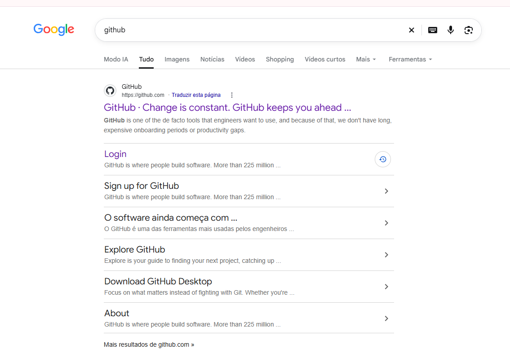

*2* - Ao entrar no site, você duas opções: Criar conta (sing up) ou Entrar em uma conta (sing in) caso você já tenha uma. <bv>

**Obs:** Na hora de criar conta você terá a opção de se conectar com Google, coloque seu melhor email para receber as notificações do GitHub.

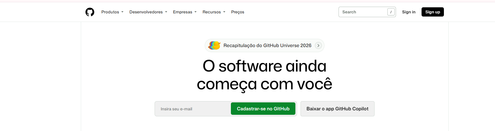

*3* - Pronto Agora você entrou em sua conta no GitHub!  

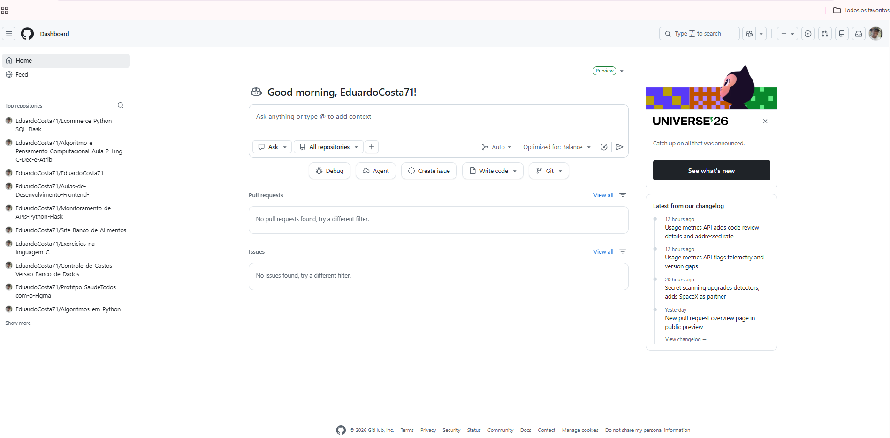

***

**Passo 2** - Como criar um repositório no GitHub?

 -  Agora que você criou sua conta no GitHub chegou a hora de colocar seus projetos em um repositório! E vamos te ensinar como fazer isso.

*1* - Na sua tela inicial você terá no canto superior direito um sinal de **+**, clique neste sinal e você terá a opção de **New Repository** (Novo Repositório).

**Obs:** Na imagem de Exemplo foi marcado de roxo para indicar.

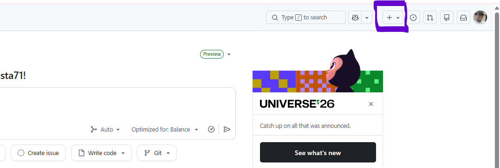   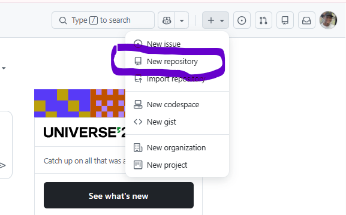

*2* - Logo após você clicar em criar em **New repository**, vai abrir uma tela para você com a criação do repositorio.

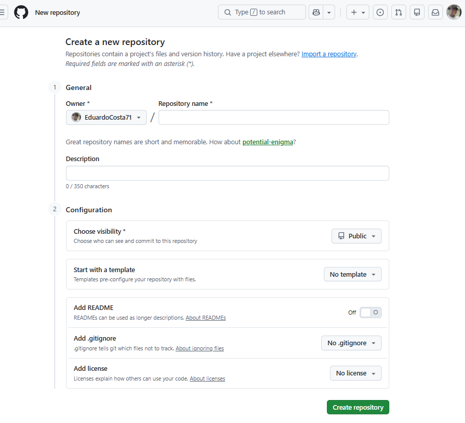

*3* - Clique dentro do input aonde está escrito **Repository name** e de um nome para o projeto que deseja. Depois de dar o nome clique em **Description** aonde você dará uma descrição para seu
projeto, lembrando que essa parte será opcional.

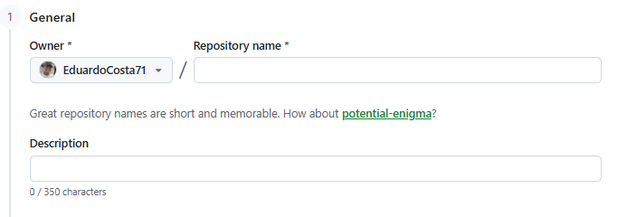

*4* - Indo para baixo, você vai se deparar com a 2 sessão **Configuration**, que seria a configuração de seu projeto.

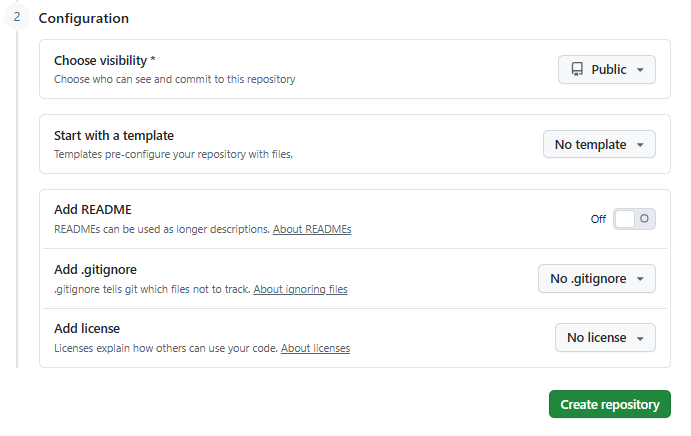

*5* - Na opção **Choose visibility**, terá **Public** ou **Private**, se você prefere que outras pessoas possam ver seu código deixe públic se não pode deixar privado que só você terá acesso.

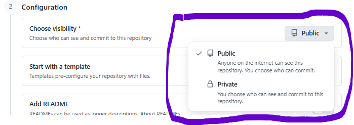

*6* - Em **Add README** terá as opções de **On e Off**, o README básicamente serve para você adicionar uma breve descrição sobre seu projeto, quais tecnologias, modo de rodar etc. Recomendo deixar ele **On** para ser adicionado essa descrição do seu projeto.

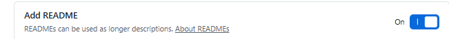

*7* - A opção **Add .gitignore** será colocada na hora de produção do seu projeto, essa opção é de esconder alguma parte do seu projeto que você não quer que entre no seu GitHub, e com essa opção você pode ocultar.

*8* - Logo quando for preenchida todas as opções, clique em **Create repository**.

#### Pronto agora você aprendeu a criar um arquivo no Github! [Acesse o GitHub por este Link](https://github.com/)

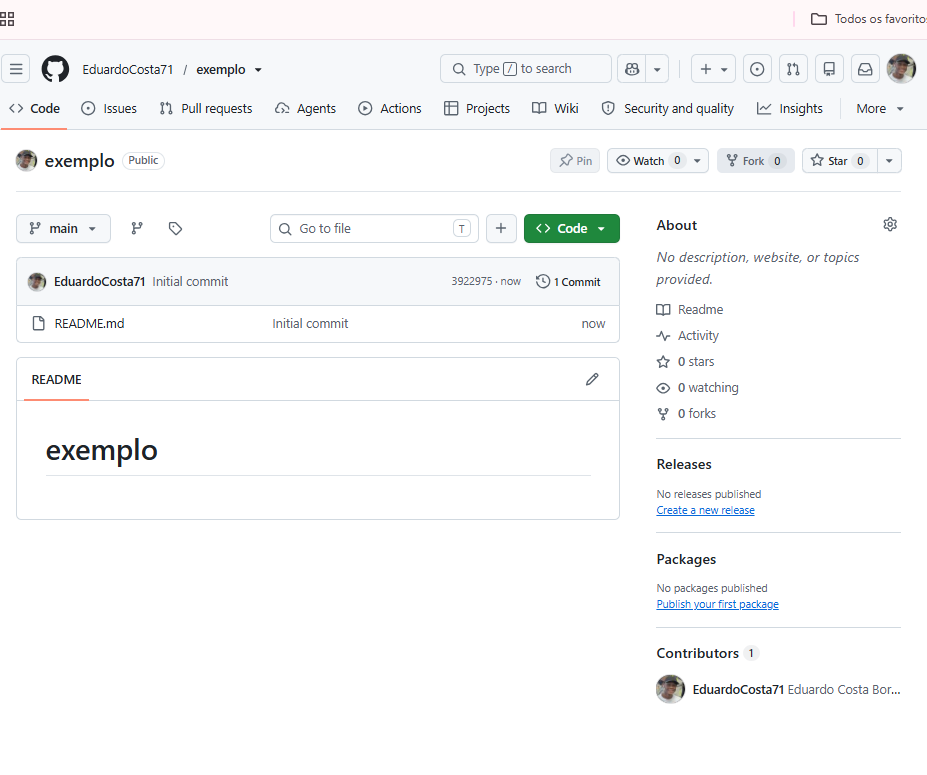

**Passo 3** - Oque é uma README?

 - O **README** é um arquivo utilizado para apresentar e explicar um projeto dentro de um repositório do GitHub. Ele funciona como uma documentação inicial, permitindo que outras pessoas entendam o objetivo do projeto, seu funcionamento e como utilizá-lo.

*O arquivo geralmente possui o nome README.md, em que:*

- README: significa, em inglês, algo como "leia-me".
- .md: indica que o arquivo utiliza a linguagem Markdown, usada para formatar textos.
  
   **Para que serve um README?**
  
O README pode ser utilizado para:

'1. Apresentar o projeto e seus objetivos.

'2. Explicar as funcionalidades disponíveis.

'3. Mostrar como utilizar ou executar o projeto.

'4. Informar as tecnologias utilizadas.

'5. Apresentar os integrantes e colaboradores.

'6. Disponibilizar links e imagens relacionados ao projeto.

 ## **Como funciona?**
Quando alguém acessa um repositório no GitHub, o conteúdo do README.md é exibido automaticamente na página inicial, facilitando a compreensão do projeto sem precisar abrir cada arquivo.

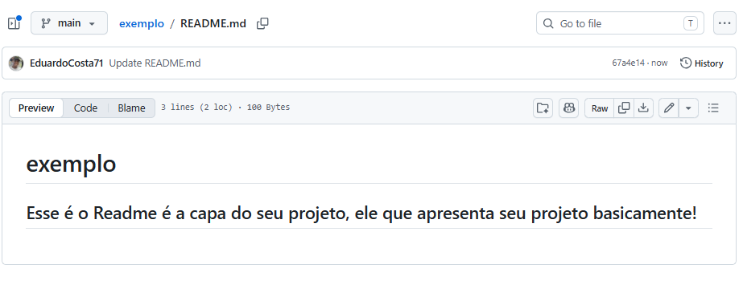

Conferido profa. Eliane Ribeiro
